  <picture>
    <source media="(prefers-color-scheme: dark)" srcset="./assets/banner_compact_dark.svg" />
    <source media="(prefers-color-scheme: light)" srcset="./assets/banner_compact_light.svg" />
    
  </picture>

  <em>Let open-source win!</em>

  
  
  

---

### Featured Projects

| Project | Stack | Description |
| :--- | :--- | :--- |
| [**ExtraIsland**](https://github.com/LiPolymer/ExtraIsland) | `C#` · `.NET` · `Avalonia` | Feature-rich ClassIsland plugin with smooth clocks, countdowns, and duty rosters. |
| [**ShulkerRDK**](https://github.com/LiPolymer/ShulkerRDK) | `C#` · `.NET` | Modular low-code modding tool, resource composer, and CI/CD provider for Minecraft development. |

---

### I'm working with...

---

### 📈 Stats

  <picture>
    <source media="(prefers-color-scheme: dark)" srcset="https://github-stats-extended.vercel.app/api?username=LiPolymer&show_icons=true&theme=transparent&hide_border=true&title_color=86D6BE&icon_color=86D6BE&text_color=C9D1D9&ring_color=86D6BE" />
    <source media="(prefers-color-scheme: light)" srcset="https://github-stats-extended.vercel.app/api?username=LiPolymer&show_icons=true&theme=transparent&hide_border=true&title_color=0F6B57&icon_color=0F6B57&text_color=294B5E&ring_color=0F6B57" />
    
  </picture>
  <picture>
    <source media="(prefers-color-scheme: dark)" srcset="https://github-stats-extended.vercel.app/api/top-langs/?username=LiPolymer&layout=compact&langs_count=8&hide=typescript,dockerfile,c,xslt,mdx&theme=transparent&hide_border=true&title_color=86D6BE&icon_color=86D6BE&text_color=C9D1D9" />
    <source media="(prefers-color-scheme: light)" srcset="https://github-stats-extended.vercel.app/api/top-langs/?username=LiPolymer&layout=compact&langs_count=8&hide=typescript,dockerfile,c,xslt,mdx&theme=transparent&hide_border=true&title_color=0F6B57&icon_color=0F6B57&text_color=294B5E" />
    
  </picture>

